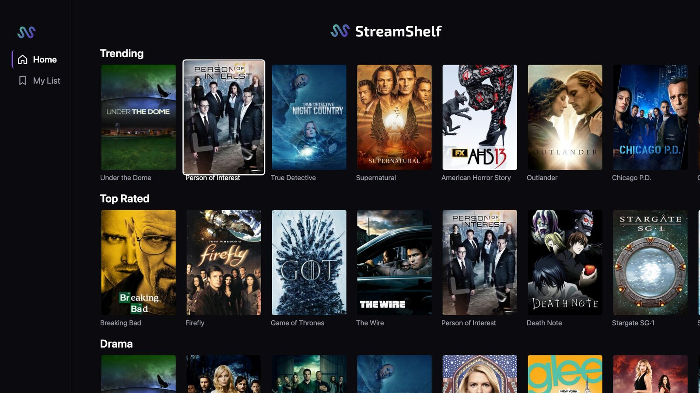
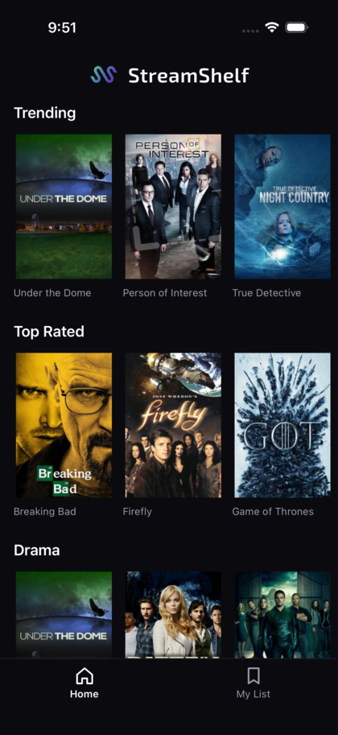
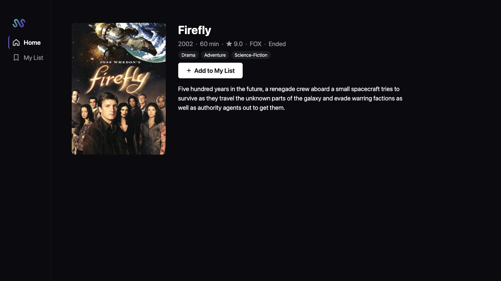
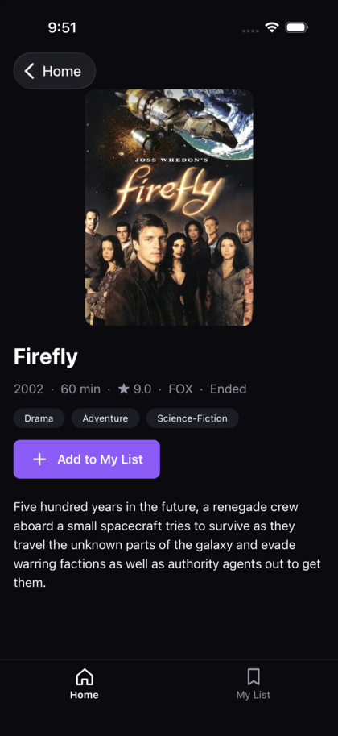
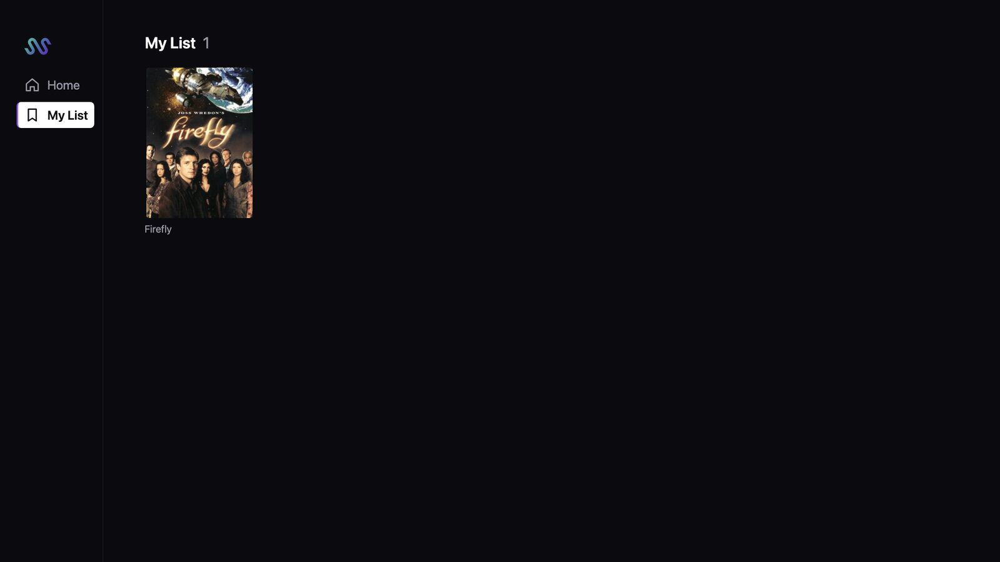
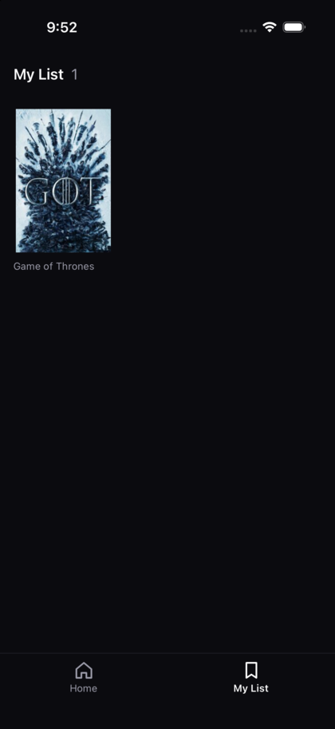
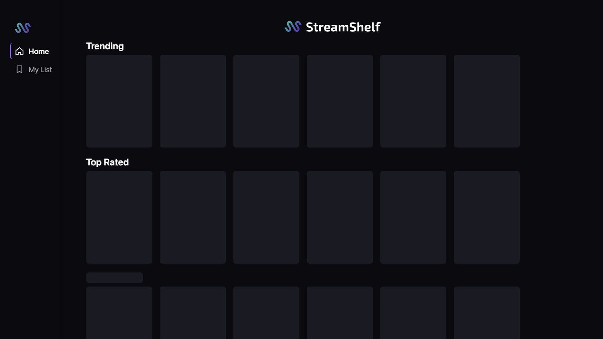
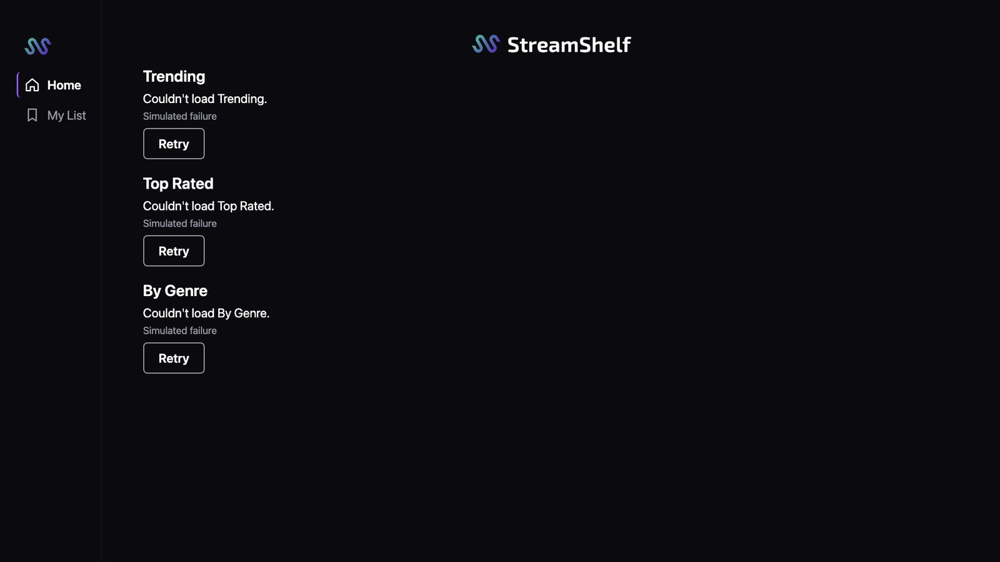

# StreamShelf

A small streaming catalog built once in React Native + TypeScript for phone, TV and web: three content rails, a detail screen, and a My List that survives restarts. Directional focus (remote or keyboard) is treated as a first-class input, not an afterthought.

<p align="center">
  
  &nbsp;
  
</p>
<p align="center"><sub>Web at 1920×1080 (ten-foot layout, arrow-key focus on <i>Person of Interest</i>) · iPhone 17 Pro, iOS 26.1</sub></p>

---

## Getting running

**Prerequisites**

| | Version used | Needed for |
|---|---|---|
| Node | 24 | everything |
| Xcode | 26.4 or newer (built with 27.1) | iOS and tvOS. Expo SDK 57 requires 26.4+ |
| iOS Simulator runtime | **iOS 26.x** | iOS. See [iOS 27](#limitations-and-next-steps) |
| CocoaPods | 1.17 | iOS and tvOS |

```bash
npm install          # also enables the pre-push hook (.githooks)
```

**Web** (fastest way to try it; arrow keys stand in for a remote)

```bash
npm run web          # http://localhost:8081
```

Open it at 1920×1080 or wider for the ten-foot layout. Arrow keys move focus, Enter selects, Escape goes back. URL parameters drive the data source and simulation, so every state can be demoed on demand:

| URL | Shows |
|---|---|
| `/?source=fixtures` | offline snapshot instead of the live API |
| `/?latency=3000` | skeleton loading for 3 s |
| `/?fail=1` | every request fails; per-rail errors with Retry |
| `/?fail=0.5` | each rail rolls independently, so some fail and some load |

**iOS (iPhone)**

```bash
npm run prebuild                      # generates ios/ and android/ for phones
xcrun simctl list devices | grep -A8 "iOS 26"   # pick an iOS 26.x simulator
npx expo run:ios --device <UDID>
```

**tvOS** (configured, not yet run, see [targets](#supported-targets))

```bash
npm run prebuild:tv                   # EXPO_TV=1: regenerates ios/ as an Apple TV project
npm run tvos
```

`prebuild` and `prebuild:tv` both use `--clean`, so switching between phone and TV regenerates the native projects. `ios/` and `android/` are generated output and are not committed.

**Tests**

```bash
npm run typecheck
npm test                              # Jest + React Native Testing Library (62 tests)
npx playwright install chromium       # once
npm run test:e2e                      # Playwright, real arrow keys at 1920×1080 (16 tests)
```

`test:e2e` starts its own dev server on port 8090 using fixtures, so it doesn't touch the network or a running dev server. The pre-push hook runs typecheck and Jest; e2e stays manual because it needs a browser.

**Maintenance scripts**

```bash
npm run fixtures     # re-snapshot TVMaze page 0 into src/catalog/fixtures/shows.json
npm run icons        # re-render app icons + favicon from assets/brand/mark.json (macOS: Quick Look + ImageMagick)
```

---

## Supported targets

| Target | Status |
|---|---|
| Web, keyboard, 1920×1080 | **Verified.** Playwright suite plus manual checks |
| iPhone, iOS 26.1 simulator | **Verified manually.** Rails, detail, My List, restart persistence |
| iPhone, iOS 27 simulators | Crashes at launch, see limitations |
| Apple TV (tvOS) | Configured. Prebuild generates a valid `appletvos` project; not run on the simulator yet |
| Android, Android TV, Fire TV | Configured through the same plugin; not built. Cut for time |
| Roku | Out of scope: Roku apps are BrightScript/SceneGraph, so there's no React Native runtime to share code with |

---

## Key decisions

**Expo (prebuild) over the React Native Community CLI.** Expo prebuild over Community CLI because it produces identical native projects while adding config plugins for TV targets and a free web target; the tradeoff is SDK version coupling with the tvOS fork, which is acceptable at this dependency surface. One codebase runs on iPhone, Apple TV, Android TV and web, and `@react-native-tvos/config-tv` switches the generated projects to TV with `EXPO_TV=1`. Nothing patches native code: every native change comes from a config plugin. A mature production CTV app with heavy native integration (custom players, DRM, vendor SDKs) might still choose bare CLI for full control of the native projects, but that isn't the problem this exercise poses.

**Expo SDK 57 + react-native-tvos 0.86 rather than SDK 58 + 0.88.** At scaffold time the 0.88 fork release was a week old; 0.86 had months behind it. Lower risk inside a timebox. Cost: SDK 57 needs Xcode 26.4+, and its generated app doesn't adopt the UIScene lifecycle that iOS 27 enforces.

**One data source interface, three implementations.** `CatalogService` has `getShows()` and `getShow(id)`. The live implementation calls TVMaze (no API key) and makes **one** `/shows` request, which every rail shares and which isn't cached on failure. The fixture implementation reads a snapshot of the same page, so the app runs offline and tests are deterministic. `withSimulation()` wraps either one with latency and a failure rate *per call*: rails share the one network request but fail independently, which is what makes partial failure demoable.

**Rails are config.** `RAILS` is an array of `{ id, title, select }` over the show list: Trending (TVMaze `weight`), Top Rated, and the most common genre, whose title comes from the data. Adding a rail is a one-line change.

**A hand-written `useAsync` instead of TanStack Query or RTK Query.** It returns `status / data / error / retry` and drops results from superseded runs, in about 40 lines that can be walked through line by line. Each rail calls it independently. Caching and request sharing live in the service, the only place this app needs them.

**My List: zustand + `persist` on async-storage, over MMKV.** async-storage has a web backend (localStorage), so one store works everywhere. The list stores summary snapshots (id, name, image) rather than ids, so it renders instantly and offline. The detail screen still fetches fresh data. The toggle stays disabled until the store has loaded from storage, because a write before then would be overwritten.

**React Navigation native stack**, which handles the TV back/menu button natively. Expo Router was ruled out because the TV plugin doesn't support it on tvOS.

**Focus: the platform engine on TV, and a documented simulation on web.**
- **TV:** no custom spatial-navigation system. `Pressable` `onFocus`/`onBlur` drive a border and scale, `hasTVPreferredFocus` sets initial focus, and each rail sits in a `TVFocusGuideView autoFocus`, so moving vertically returns to that rail's last tile.
- **Web:** a thin layer ([`webFocus.ts`](src/focus/webFocus.ts), [`spatial.ts`](src/focus/spatial.ts)) maps arrow keys onto the same focus callbacks and reproduces the guide behaviour. It **simulates** the TV engine and doesn't replace it; native builds never load it.
- **Back:** on web, Escape restores focus to the tile you came from, matching what the TV engine does when a screen is popped.
- **Hover:** none on web. Focus is drawn by the components, and the browser outline is suppressed.

**One codebase, one `Platform.isTV` branch for scale.** TV and wide web get ten-foot sizing, overscan-safe margins (~5% of 1080p), poster-sized tiles, and no touch affordances such as scroll indicators. Navigation is a left sidebar on TV and web, the convention for directional input, and a bottom tab bar on phones. Everything else is shared.

**Testing in the order the brief cares about: focus, data, render.**

| | Tool | Covers |
|---|---|---|
| Focus | Jest + jsdom, Playwright | the spatial picker; the web layer (guide memory, sidebar, screen entry, Back restore); real arrow keys at 1920×1080 |
| Data | Jest | live/fixture services, failure then retry, simulation, fixture integrity, rails, store add/remove/persist/hydrate |
| Render | React Native Testing Library | each rail and poster state; detail states and toggle; adding on detail shows the show in My List |

Focus depends on layout, which jsdom can't compute, so the arrow-key behaviour is also checked in a real browser.

**Brand assets from one source.** The logo geometry lives in [`assets/brand/mark.json`](assets/brand/mark.json). The in-app logo and `npm run icons` (iOS, Android adaptive, favicon) both read it, so they can't drift apart.

---

## Screens

| | Web (1920×1080) | iPhone |
|---|---|---|
| Detail |  |  |
| My List |  |  |
| Loading |  | |
| Rail errors |  | |

---

## Project layout

```
src/
  catalog/      CatalogService (live, fixtures, simulation), TVMaze mapper, rails config, fixture snapshot
  hooks/        useAsync, usePulse
  myList/       persisted zustand store
  focus/        web-only arrow-key layer + spatial picker (simulates the TV focus engine)
  components/   ShowTile, Poster, RailRow, FocusGuide, FocusButton, skeletons, brand
  screens/      Home, Detail, My List
  navigation/   native stack, sidebar / bottom bar
  settings/     dev settings (source, latency, failure rate)
test/           factories and render helpers
e2e/            Playwright specs
scripts/        fixture snapshot, icon export
```

---

## Limitations and next steps

- **tvOS hasn't run yet.** Prebuild produces a correct Apple TV project, but native focus (sidebar, guides, back) is unverified on the tvOS simulator. That's the next thing to do. If rails of uneven length send focus somewhere unexpected, `nextFocusUp` and `nextFocusDown` are the planned fix; the autoFocus guides have made them unnecessary so far.
- **Android and Android TV haven't been built.** They're configured but were cut for time.
- **iOS 27 crashes at launch.** iOS 27 requires the UIScene lifecycle, which the SDK 57 template doesn't adopt. Fixing it means native changes, which this project avoids, so run on iOS 26.x. An SDK upgrade is the clean fix.
- **There's no in-app debug panel.** Data source, latency and failure rate are URL parameters on web only. On native they're defaults in `src/settings/devSettings.ts`.
- **Detail has no URL.** Refreshing the web app on a detail page returns to Home. Linking config would fix it.
- **Trending is coarse.** TVMaze's `weight` tops out at 100, and 31 of the 240 snapshot shows have exactly 100, so Trending is effectively "popular, in id order". Drama makes up 154 of the 240 shows, so the genre rail overlaps Trending heavily.
- **Web posters depend on image decoding.** react-native-web reports an image as loaded only after `image.decode()` resolves. Hidden or background tabs can defer that, which leaves the placeholder showing; there's no timeout fallback.
- **Simulator taps.** In the iOS simulator the first tap after a launch or navigation was sometimes ignored. It hasn't been checked on a physical device.
- **Not attempted:** search, pagination beyond page 0, a screen-reader pass (roles and labels exist but aren't audited), CI.

---

## How AI was used

Built with **Claude Code** as a pair programmer. I set the constraints and the architecture up front (the decisions above: Expo prebuild with the tvOS fork, the CatalogService shape, a hand-written `useAsync`, zustand on async-storage, native focus with a web simulation), chose between options when they came up, approved every commit, and steered the design and branding. Claude Code checked library compatibility, scaffolded the project, and wrote most of the code and tests.

**Verification:**
- **Every change:** typecheck, Jest, and Playwright for anything touching focus.
- **Every commit:** typechecked and tested on its own in a clean worktree before pushing.
- **Manual:** checked on the iPhone simulator and in a browser at 1920×1080.

Problems found along the way went into the code or into the limitations above:
- the npm peer-dependency workaround for the fork's version numbers;
- the Xcode 26.4 requirement and the iOS 27 crash;
- Quick Look's white background in the icon export;
- web image decoding in hidden tabs.
